# Linux, användare, diskar och databas

Repository: https://github.com/03timnor/Linux_MOV25

*Tim Noreliusson Lingestedt, 2026-11-07*

Linux-administration på *EC2*-servrar (*Amazon Linux*), en bastion och en webbserver.

## Modul 1: Användare, behörigheter och åtkomst

### *__1. Kommandon__*

#### __Skapa nyckelpar:__

*__OBS!__* På ens egna dator via en separat *bash* terminal.

```bash
cd ~/.ssh
ssh-keygen -t ed25519 -f ops-anna
cat ops-anna.pub
```

#### __Ta fram servrarnas IP-adresser:__

```bash
aws ec2 describe-instances --region eu-north-1 \
  --filters Name=tag:Name,Values=novatrix-bastion,novatrix-webb Name=instance-state-name,Values=running \
  --query 'Reservations[].Instances[].[Tags[?Key==`Name`].Value|[0],PublicIpAddress,PrivateIpAddress]' \
  --output table
```

#### __Skapa *ops-anna* på *Bastion*:__

- Logga in på *Bastion* (*ec2-user*):
```bash
ssh -i ~/.ssh/AWS_MOV25.pem ec2-user@51.20.82.182
```

- Skapa grupp och konto, lägg till den publika *SSH*-nyckeln och sätt ägare och rättigheter så att *sshd* godkänner nyckeln:

```bash
sudo groupadd drift
sudo useradd -m -G drift ops-anna
sudo mkdir -p /home/ops-anna/.ssh
echo "ssh-ed25519 FYLL I PUBLIK SSH NYCKEL" | sudo tee /home/ops-anna/.ssh/authorized_keys
sudo chown -R ops-anna:ops-anna /home/ops-anna/.ssh
sudo chmod 700 /home/ops-anna/.ssh
sudo chmod 600 /home/ops-anna/.ssh/authorized_keys
exit
```

#### __Skapa *ops-anna* på webbserver:__

- Logga in på *Webbserver* (*ec2-user*):
```bash
ssh -i ~/.ssh/AWS_MOV25.pem \
  -o ProxyCommand="ssh -i ~/.ssh/AWS_MOV25.pem -W %h:%p ec2-user@51.20.82.182" \
  ec2-user@10.0.2.50
```

- Skapa grupp och konto, lägg till den publika *SSH*-nyckeln och sätt ägare och rättigheter så att *sshd* godkänner nyckeln:

```bash
findmnt /var/www/html
sudo groupadd drift
sudo useradd -m -G drift ops-anna
id ops-anna
sudo mkdir -p /home/ops-anna/.ssh
echo "ssh-ed25519 FYLL I PUBLIK SSH NYCKEL" | sudo tee /home/ops-anna/.ssh/authorized_keys
sudo chown -R ops-anna:ops-anna /home/ops-anna/.ssh
sudo chmod 700 /home/ops-anna/.ssh
sudo chmod 600 /home/ops-anna/.ssh/authorized_keys
sudo cat /home/ops-anna/.ssh/authorized_keys
```

#### __Skapa *SSH*-config:__

*__OBS!__* På ens egna dator via en separat *bash* terminal.

```bash
cat > ~/.ssh/config <<'EOF'
Host novatrix-bastion
    HostName 51.20.82.182
    User ops-anna
    IdentityFile ~/.ssh/ops-anna

Host novatrix-webb
    HostName 10.0.2.50
    User ops-anna
    IdentityFile ~/.ssh/ops-anna
    ProxyJump novatrix-bastion
EOF
cat ~/.ssh/config
```

#### __Skapa *sudo*-regel:__

(Körs på webbservern, *ec2-user*)

```bash
sudo visudo -f /etc/sudoers.d/drift  # innehåll: %drift ALL=(ALL) NOPASSWD: ALL
```

#### __Logga in som *ops-anna*:__

```bash
ssh novatrix-webb
```

#### __*sudo*-kontroll:__

(Körs på webbservern)

```bash
sudo chmod 0440 /etc/sudoers.d/drift
sudo whoami
sudo visudo -c
sudo -l -U ops-anna
```

#### __*SSH*-inställningar:__

(Körs på webbservern)

```bash
sudo sshd -T | grep -iE "authentication|forwarding|permitroot"
sudo cat /etc/ssh/sshd_config.d/10-novatrix.conf
```

#### __Kontroll av lösenordsinloggning:__

*__OBS!__* På ens egna dator via en separat *bash* terminal.

```bash
ssh -o PubkeyAuthentication=no -o PreferredAuthentications=password novatrix-webb
ssh -o PubkeyAuthentication=no -o PreferredAuthentications=password ops-anna@51.20.82.182
```

#### __*/var/www/html*-kontroll:__

(Körs på webbservern)

```bash
findmnt /var/www/html
ls -la /var/www/html
stat -c '%U:%G %a %n' /var/www/html/wp-config.php
sudo -u ops-anna grep DB_PASSWORD /var/www/html/wp-config.php
sudo find /var/www/html -perm -o+w
```

#### __*chmod* och *chown* test:__

(Körs på webbservern)

```bash
sudo chmod 600 /var/www/html/wp-config.php
stat -c '%U:%G %a %n' /var/www/html/wp-config.php
sudo -u ops-anna grep -c DB_PASSWORD /var/www/html/wp-config.php
sudo chown root /var/www/html/wp-config.php
sudo chmod 640 /var/www/html/wp-config.php
stat -c '%U:%G %a %n' /var/www/html/wp-config.php
```

#### __Uppdaterings-kontroll:__

(Körs på webbservern)

```bash
cat /etc/os-release
rpm -q system-release
dnf check-release-update
```

### *__2. Uppgiftens övriga frågeställningar__*

#### __*ops-anna* har inget lösenord, eftersom hon loggar in med nyckel. Ta reda på vad det betyder för *sudo*, och välj och motivera en lösning__

*sudo* kräver användarens eget lösenord. *ops-anna* har inget, och i `/etc/shadow` står `!!` (låst). Inget hon skriver kan därför stämma, så *sudo* fungerar inte för henne. Inloggningen fungerar ändå, eftersom *SSH*-nycklar inte använder lösenordet.

__Lösning: `NOPASSWD` för gruppen *drift*__ i `/etc/sudoers.d/drift`:

    %drift ALL=(ALL) NOPASSWD: ALL

Motivering:
- Samma modell som *AWS* använder för *ec2-user*. Inget lösenord som kan läcka eller som behöver hanteras.
- Regeln gäller gruppen, inte personen. Nya driftpersoner läggs bara till i *drift*.
- Nyckeln blir enda faktorn och bör därför skyddas med en lösenfras.
- Filen skapades med `visudo`, som kontrollerar syntaxen, och har rättigheterna `0440`.
- Bastionen får ingen *sudo*-regel. Där behöver *ops-anna* bara hoppa vidare, vilket följer principen om minsta möjliga behörighet.

Alternativet, ett lösenord enbart för *sudo*, ger två faktorer men ett extra lösenord att hantera.

#### __Visa att inloggning med lösenord är avstängd i *SSH* och hur du tog reda på det__

`sshd -T` visar den faktiska konfigurationen efter att alla filer lästs in: `passwordauthentication no` och `kbdinteractiveauthentication no`. Inställningarna kommer från `/etc/ssh/sshd_config.d/10-novatrix.conf`, som V45-skriptet skapar. *sshd* använder det första värdet den hittar, så filen vinner över *Amazon Linux* egen `50-redhat.conf`.

Testat från min dator genom att tvinga fram lösenord (`-o PubkeyAuthentication=no -o PreferredAuthentications=password`). Både webbservern och bastionen svarar `Permission denied (publickey,gssapi-keyex,gssapi-with-mic)` utan att fråga efter lösenord. `password` finns inte bland de tillåtna metoderna.

Man kan se att det är avstängt i nästa steg "*3. Verifiering*".

#### __Förklara ägare och rättigheter på /var/www/html. Finns det någon fil där med för öppna rättigheter? Vad betyder det, och hur rättar du det? WordPress sparar databasens lösenord i en av filerna i katalogen. Vem på servern kan läsa den?__

`/var/www/html` är inte lokal disk utan *EFS*, monterat via *NFS* över en *TLS*-tunnel (`findmnt` visar `127.0.0.1:/ nfs4`). Allt ägs av `apache:apache` (uid/gid 48), även filer som root skapade, eftersom *EFS*-access pointen tvingar alla anrop till uid 48. Filer har `644` och kataloger `755`. Inga filer är skrivbara för alla (`find -perm -o+w` gav inget). Filen med för öppna rättigheter är `wp-config.php`.

`wp-config.php` hade `644`, alltså läsbar för alla. Den innehåller databasens lösenord (`DB_PASSWORD`), och *ops-anna* kunde läsa det utan *sudo*.

Rättat med `chmod 640`, eftersom "övriga" inte ska kunna läsa filen. Webbplatsen fungerar fortfarande, eftersom *PHP* läser filen som `apache`, som är ägaren. Testet visade dock att det inte räcker här: även med `600` kunde *ops-anna* läsa filen, och `chown root` nekades. Access pointen gör att alla läsningar når *EFS* som uid 48, alltså som ägaren. *Linux*-rättigheterna kan därför inte skilja användarna åt.

Alla som har ett skal på webbservern kan läsa lösenordet, dels via filen på *EFS*, dels via *SSM* (`/novatrix/db/wordpress-losenord`). Serverns *IAM*-roll får läsa *SSM*, och rollens nycklar kan hämtas av alla lokala användare från metadatatjänsten.

Skyddet ligger därför i lagren runt omkring:
- Bara gruppen *drift* kommer in, och bara via bastionen med nyckel.
- Databasanvändaren får bara logga in från webbnivån (`10.0.2.0/23`) och bara mot databasen *wordpress*.
- *RDS* tar bara emot trafik från `web-sg`, kräver *TLS* och saknar publik IP.

Bättre lösning vore att flytta lösenordet till en fil på lokal disk (root, `600`) som *php-fpm* läser, och att begränsa metadatatjänsten till root med *iptables*.

#### __Ta reda på vilken version av Amazon Linux 2023 servern kör, om det finns en nyare, och hur uppdateringar fungerar i Amazon Linux 2023__

Servern kör *Amazon Linux 2023.12.20261102*, med support till 2029-06-30. `dnf check-release-update` gav ingen utskrift, så det finns ingen nyare release.

*AL2023* har versionerade paketförråd: servern är låst till sin release, och `dnf upgrade` uppdaterar bara inom den. Nyare releaser, med nya säkerhetsfixar, måste man byta till aktivt med `dnf upgrade --releasever=<version>` eller `--releasever=latest`. Fördelen är att samma *AMI* och samma kommando alltid ger exakt samma paket, så en testad release kan rullas ut oförändrad. Alternativet är att byta ut servern mot en ny från en nyare *AMI*. Det passar här, eftersom webbservern inte har eget tillstånd: allt ligger i *EFS*, *RDS* och *S3*.

### *__3. Verifiering__*

#### __Test av *chmod* och *chown* på *EFS*__

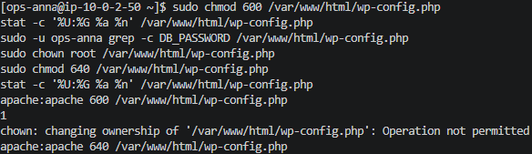

#### __*SSH*-inställningar:__

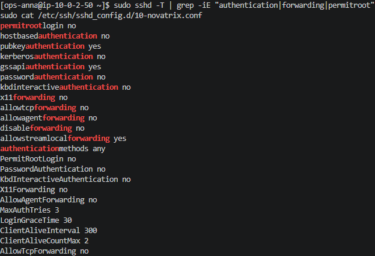

#### __Lösenordsinloggning nekas:__

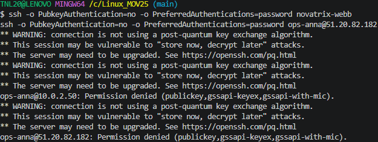

#### __*sudo*-regel:__

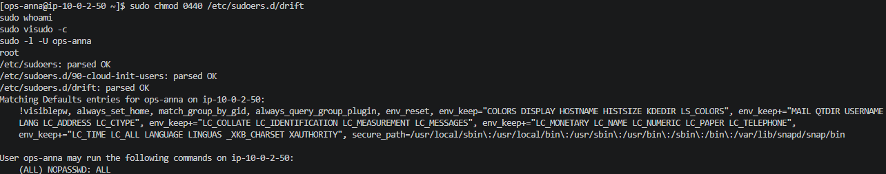

#### __Uppdaterings-kontroll:__

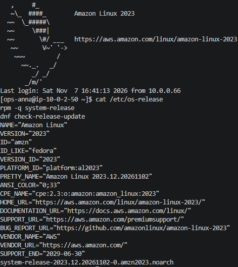

#### __Webbplats funferar efter ändring:__

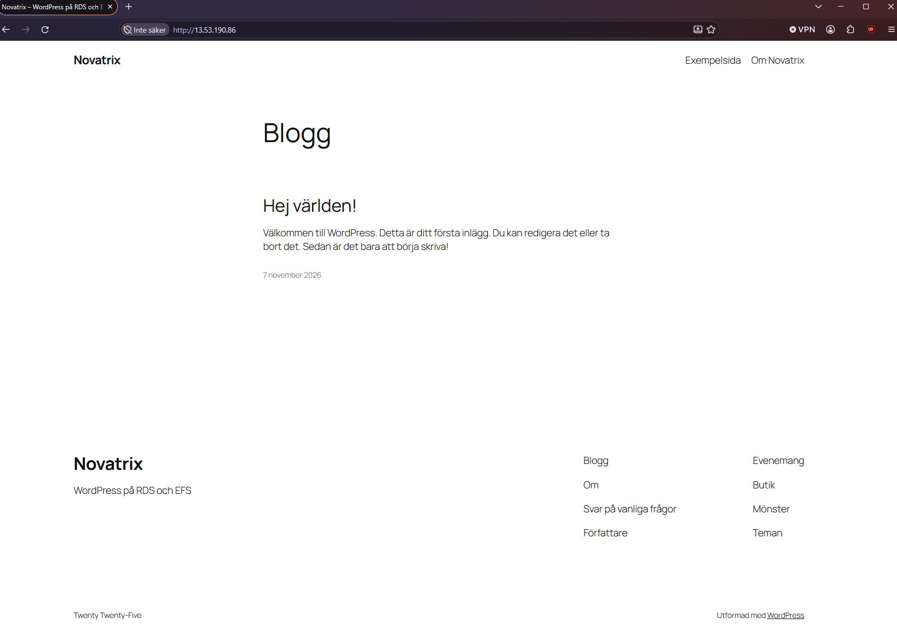

#### __Ägare och rättigheter i */var/www/html*:__

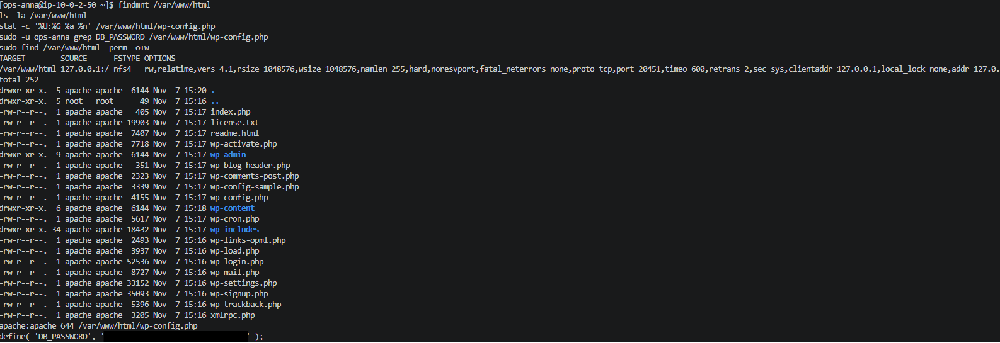

## Modul 2: En extra disk

### *__1. Kommandon__*

#### __Lista diskar__

```bash
lsblk -f
```

#### *__Kontrollera vas som finns på disken:__

```bash
sudo file -s /dev/nvme1n1
```

(Svarar den *data* så¨är den tom/inget filsystem och måste formateras innan användning).

#### __Formatera disk:__

```bash
sudo mkfs.xfs -L testdisk  /dev/nvme1n1
```

(Formaterar disken med filsystem *XFS* som är standard i *Amazon Linux* )

#### __Skapa monteringspunkt:__

```bash
sudo mkdir -p /data
```

#### __Montera disken tillfälligt:__


```bash
sudo mount /dev/nvme1n1 /data
sudo sf -h /data
sudo findmnt /data
```
Ska visa cirka *1GB* storlek och *xfs* som filsystem/*fstype*. 

#### __Testa disken__

```bash
cho "TEST" | sudo tee /data/test.txt
cat /data/test.txt
ls -la /data
```

Bör nu visa att det finns en fil som heter "*test.txt*" på disken.

#### __Hämta diskens *UUID*:__

```bash
sudo blkid /dev/nvme1n1
```

Säkerhetskopiera *fstab* och lägg till raden:

```bash
 sudo blkid /dev/nvme1n1
/dev/nvme1n1: LABEL="testdisk" UUID="1fc5c8bb-c2bf-4a90-bbef-5cf696558a39" BLOCK_SIZE="512" TYPE="xfs"
[ec2-user@ip-10-0-2-144 ~]$ sudo cp /etc/fstab /etc/fstab.bak
UUID=$(sudo blkid -s UUID -o value /dev/nvme1n1)
echo "UUID=$UUID  /data  xfs  defaults,nofail  0  2" | sudo tee -a /etc/fstab
cat /etc/fstab
```

#### __Starta om servern:__

```bash
sudo reboot
```

#### __Kontrollera att disken fortfarande är monterad och att testfil är kvar__:

```bash
findmnt /data
df -h /data
cat /data/test.txt
```

#### __Kontrollera hur mycket plats som används i */var*:__

```bash
df -hT / /data /var/www/html
```

#### __Kontrollera vad som tar mest plats i */var*:__

```bash
sudo du -xh --max-depth=1 /var 2>/dev/null | sort -rh | head -10
```

### *__2. Verifiering__*

#### __*XFS*-formattering:__

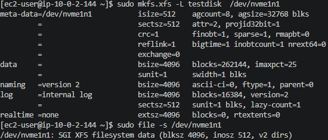

#### __Montering:__

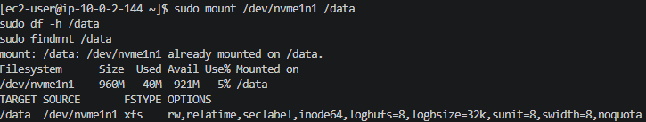

#### __Skriva och läsa:__

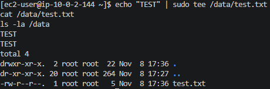

#### __Disken är kvar efter omstart:__

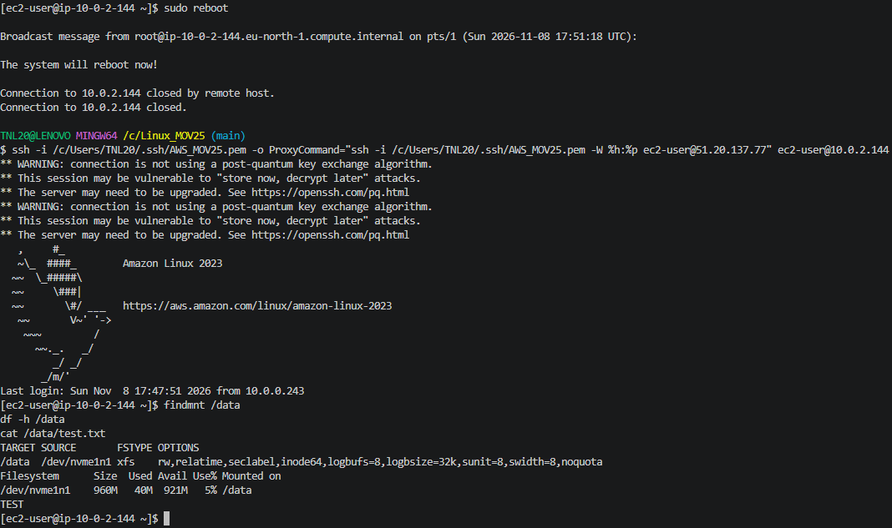

#### __*/var* utrymme:__

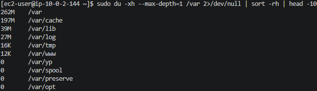

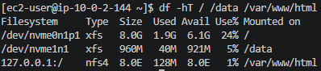

## Modul 3: Databasen från kommandoraden

